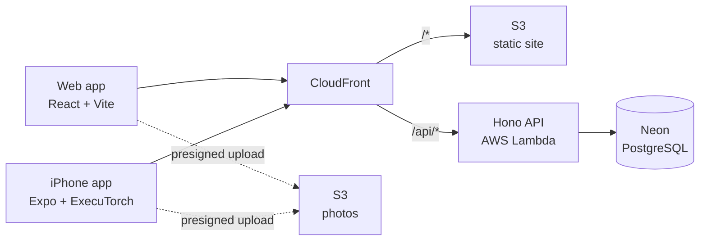

<div align="center">

# Stylify

**A virtual wardrobe for the web and iPhone, with an on-device model that recognises your clothes.**

[**stylify.space**](https://stylify.space)


</div>

---

## What it does

- **Catalogue your clothes.** Photograph an item, give it a name, type, size and colour, and browse your wardrobe as a grid on the web or on your phone.
- **Let the phone tag it for you.** The iPhone app runs a clothing classifier on the device. It pre-fills the type when it is confident, and offers its best guess when it is not. No photo leaves the phone to be classified.
- **One account everywhere.** Sign in with Kinde on either app; both talk to the same typed API.

## The classifier

A 9-class model (top, outerwear, trousers, shorts, skirt, dress, shoes, hat, bag), fine-tuned from **EfficientNet-B0 in PyTorch** and exported to **ExecuTorch** to run on the iPhone (16 MB).

| | Old model | Current model |
|---|---|---|
| Photos taken in ordinary rooms (989 held out) | 0.788 | **0.926** |
| Volunteers' own photos (1,754 held out) | 0.892 | **0.913** |

- Trained on **127K images from 8 public datasets**, with room photos oversampled so the model learns clothes on beds, floors and hangers, not just on models.
- A **five-run sweep on Kaggle GPUs** picked the source weighting and learning rate.
- The **confidence threshold is calibrated** so that at least 95% of the types it fills in confidently are right on held-out photos.

The full pipeline (data preparation, training, evaluation, export) lives in [`ml/`](ml); the method and results are in [docs/ml.md](docs/ml.md).

## Architecture



- **End-to-end types.** The Hono server exports its route types; the web and mobile apps call it through a typed RPC client, and one set of Zod schemas in `shared/` validates the form, the route and the database.
- **Serverless.** The API is a Bun container on Lambda behind CloudFront, so the whole stack costs cents a month.
- **Direct uploads.** Photos go straight from the client to S3 with a presigned URL; the API never handles the file.

## Tech stack

| Layer | Technology |
|---|---|
| Web | React 19, Vite, TanStack Router, Query and Form, Tailwind CSS, framer-motion |
| Mobile | Expo SDK 55, Expo Router, react-native-executorch |
| API | Hono on Bun, Zod, Drizzle ORM |
| Data | Neon (serverless PostgreSQL), AWS S3 |
| Auth | Kinde (OAuth 2.0; cookies on the web, bearer tokens on the phone) |
| ML | PyTorch, timm, ExecuTorch (XNNPACK), Kaggle GPUs, uv |
| Infra | AWS Lambda, ECR, API Gateway, CloudFront, GitHub Actions |

## Repository layout

```
server/     Hono API, deployed to AWS Lambda as a container
frontend/   React + Vite web app, deployed to S3 behind CloudFront
shared/     Zod schemas, types and brand tokens shared by every app
mobile/     Expo iPhone app
ml/         Python project that trains and exports the clothing classifier
infra/      CloudFront Function source
docs/       Architecture and design docs
```

## Running locally

Needs [Bun](https://bun.sh) 1.3 and a `.env` with `DATABASE_URL`, `AWS_BUCKET_NAME`, `AWS_BUCKET_REGION` and the Kinde credentials.

```bash
bun install               # every workspace, from the repo root
bun run dev               # API on :8080
bun run dev:frontend      # web app on :5173, proxies /api to :8080
```

- **iPhone app:** `cd mobile && bunx expo run:ios --device "iPhone 17"` (needs Xcode). See [docs/mobile.md](docs/mobile.md).
- **Classifier:** `cd ml && uv run pytest` (needs [uv](https://docs.astral.sh/uv/)). See [docs/ml.md](docs/ml.md).

## Deployment

Pushing to `main` deploys through GitHub Actions:

| Workflow | Runs when a push touches | What it does |
|---|---|---|
| Deploy Backend | `server/`, `shared/`, `package.json` | Builds the Docker image, pushes it to ECR, updates the Lambda |
| Deploy Frontend | `frontend/`, `shared/`, `package.json` | Typechecks, builds with Vite, syncs to S3, invalidates CloudFront |

The iPhone app is installed from Xcode and is not deployed by CI.

## Documentation

| Topic | File |
|---|---|
| Backend: Hono, routes, auth | [docs/backend.md](docs/backend.md) |
| Database: Neon, Drizzle, schema | [docs/database.md](docs/database.md) |
| Frontend: routing, components | [docs/frontend.md](docs/frontend.md) |
| Mobile app | [docs/mobile.md](docs/mobile.md) |
| Clothing classifier | [docs/ml.md](docs/ml.md) |
| TanStack Query and Form | [docs/tanstack.md](docs/tanstack.md) |
| Zod schemas | [docs/zod.md](docs/zod.md) |
| Hono RPC | [docs/hono-rpc.md](docs/hono-rpc.md) |
| Request flow | [docs/data-flow.md](docs/data-flow.md) |
| Cloud architecture and deploys | [docs/cloud-architecture.md](docs/cloud-architecture.md) |
